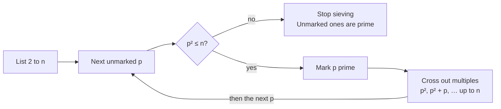

# Sieve of Eratosthenes — Requirements Specification

Oct 14, 2026 · Winsome Mundy

## Purpose and scope

The Sieve of Eratosthenes app teaches students how the sieve finds every prime up to a number they choose, by playing the algorithm one step at a time with an explanation of each step. It is a free Winsome Mundy student tool, live at [sieve.winsomemundy.com](https://sieve.winsomemundy.com/), and also published as a private Claude artifact.

In scope: one page that takes a whole number from 2 to 1,000, builds the sieve, and lets the student step through, play, rewind and finish it. The page also lists the resulting primes and explains the method.

This specification describes the app as built and deployed on 14 October 2026 (repository `winsomemundy/sieve-of-eratosthenes`, commit `cd55b1c`). Requirements use "must" for required behavior and "should" for preferred behavior.

## Users and use cases

The primary users are students in Winsome Mundy's statistics and mathematics courses; the secondary user is the instructor demonstrating the method in class.

| ID | User | Use case |
| --- | --- | --- |
| UC-1 | Student | Enter a limit and step through the sieve at their own pace, reading why each number is kept or crossed out. |
| UC-2 | Student | Play the sieve automatically at a chosen speed and pause to study a step. |
| UC-3 | Student | Jump to the final list of primes to check homework answers. |
| UC-4 | Instructor | Project the tool in class and advance one prime at a time while explaining it. |
| UC-5 | Student on a phone | Use the whole tool on a 375 px wide screen without sideways scrolling. |
| UC-6 | Keyboard or screen-reader user | Operate every control from the keyboard and hear each step's explanation. |

## Input and validation

The student must be able to enter any whole number n from 2 to 1,000 inclusive; anything else must be rejected with a message that names the problem and the fix.

| ID | Requirement |
| --- | --- |
| IN-1 | The page must show a labelled number field, "Find all primes up to (2 to 1,000)", and a "Build the sieve" button. |
| IN-2 | The field must open with the value 50, and the page must load with a sieve for n = 50 already built. |
| IN-3 | Submitting a valid n must rebuild the grid, reset to step 0 and stop any playback. |
| IN-4 | The upper limit of 1,000 keeps the grid readable; it must be enforced on submit, not only by the field's max attribute. |
| IN-5 | An invalid entry must leave the current sieve unchanged and show one error notice above the step card. |
| IN-6 | A later valid entry must hide the error notice. |

Error messages for each invalid case:

| Input | Message shown |
| --- | --- |
| Blank | No number entered. Type a whole number from 2 to 1,000. |
| Not a whole number, e.g. 2.5 | 2.5 is not a whole number. Use one such as 50. |
| Below 2, e.g. 1, 0, -5 | 1 is too small. The number must be 2 or greater. |
| Above 1,000, e.g. 1001 | 1,001 is too large for a readable grid. Use a number up to 1,000. |

## Algorithm and step model

The app must run the classic sieve: for each prime p while p² ≤ n, cross out p², p² + p, p² + 2p, … up to n; every number never crossed out is prime. The number 1 is shown but never treated as a candidate.

Each pass finds the next unmarked number p; if p² ≤ n it is prime and its multiples are crossed out, otherwise sieving stops.

| ID | Requirement |
| --- | --- |
| AL-1 | The full list of steps must be built when the sieve is built, so any step can be shown by replaying from step 0. |
| AL-2 | Crossing out must start at p², not 2p. |
| AL-3 | Every multiple from p² to n must get its own step, including numbers already crossed out by a smaller prime; those keep the prime that crossed them first. |
| AL-4 | Sieving must stop at the first unmarked p with p² > n; the final step then declares every unmarked number prime. |
| AL-5 | The result must equal the primes up to n for every n from 2 to 1,000 (168 primes at n = 1,000). |

Each step has one of six types, and each type has its own explanation sentence:

| Step type | When it occurs | What the student sees |
| --- | --- | --- |
| Start | Step 0 | Every number from 2 to n listed, none marked, and √n stated. For n = 2 a special sentence says the list holds only 2. |
| New prime | The smallest unmarked number p has p² ≤ n | p turns prime, and the sentence says crossing starts at p². |
| Cross out | Each multiple m from p² to n | m = p × k, crossed out, or noted as already crossed by an earlier prime. |
| Prime done | After p's last multiple | All multiples of p are crossed out; find the next unmarked number. |
| Stop | The next unmarked p has p² > n | Why sieving can stop now. |
| Finish | Last step | Every unmarked number is prime, with the count. |

Step counts for reference: n = 2 has 2 steps after the start, n = 50 has 55, and n = 1,000 has 1,435.

## Controls and playback

The student must be able to move through the steps one at a time, by prime, or automatically, in both directions, from buttons and from the keyboard.

| Control | Key | Behavior | Disabled when |
| --- | --- | --- | --- |
| Next step | → | Shows the next step and stops playback. | At the last step |
| Play / Pause | Space | Plays one step per interval until the end; the label switches to Pause and back. | At the last step |
| Back | ← | Shows the previous step and stops playback. | At step 0 |
| Next prime | none | Jumps to the next New prime or Stop step, or to the end. | At the last step |
| Finish | none | Jumps to the last step and shows the result. | At the last step |
| Reset | none | Returns to step 0 and hides the result. | Never |
| Speed slider | none | 10 levels; the interval is 1,100 ms ÷ 1.6^(level − 1), from 1.1 s down to about 16 ms. Changing it while playing applies at once. | Never |

Additional rules:

- Keyboard shortcuts must not fire while focus is in a text field, and Space on a focused button must press that button only.
- Playback must stop by itself at the last step.
- The cell under examination should scroll into view when it is off screen.

## Display

The page must show, top to bottom: the input card, the step card, a row of four counts, the number grid with its key, the result (once finished), the method, and an explainer. The input card also offers the printable worksheet.

**Step card.** It must show "Step i of N", a progress bar filled to i ÷ N, and the current step's sentence, with the numbers in it highlighted.

**Counts.** Four figures must update on every step: current prime p ("–" when none), primes found, crossed out, and still unmarked. Numbers of 1,000 or more use a thousands separator.

**Grid.** One cell per number from 1 to n, in rows of 10 when n ≤ 100 and as many columns as fit (cells at least 38 px) above 100. The card header shows n and √n to two decimals.

| Cell state | Look | Hover text |
| --- | --- | --- |
| 1 | Dashed border, faded | 1 is not prime |
| Not yet decided | Night ground, light border, bright number | k not decided yet |
| Prime | Gold fill, dark number | k is prime |
| Crossed out by the current prime | Violet tint, violet border, strike line | k = p × m |
| Crossed out earlier | Darkest ground, no visible border, dimmed number, 2 px strike line | k = p × m |
| Current prime | Gold outline | |
| Being examined | Violet outline | |

A key under the grid must name the five main states with matching swatches.

**Result.** After the last step, a card must show "N primes up to n" (singular for 1) and the primes separated by " · ". Leaving the last step must hide it.

**Method and explainer.** A card must list the five steps of the method. A collapsed explainer, "Why start at p² and stop at √n?", must state the rule and work it for the current n: √n, how many primes are at most √n, and which primes do the sieving.

**Printable worksheet.** The input card must offer "Print a worksheet for n", labelled with the n currently on the grid, an "Include the answer key" checkbox (off by default), and the hint that "Save as PDF" in the print window downloads it. The button opens the browser's print window with a black-on-white sheet built for that n; nothing else on the page prints. The sheet must contain:

- a header with the topic, the title "Sieve of Eratosthenes: primes up to n", and Name and Date lines
- the method as pencil instructions (circle primes, cross out multiples from p²), with √n worked for this n (shown as "= k" when n is a perfect square)
- a grid of 1 to n with 1 shaded: rows of 10 with cells at most 10 mm for n ≤ 100, rows of 20 above 100
- five questions with answer lines: the primes used to sieve, how many primes, the largest prime, other twin-prime pairs (left out when n < 5), and why sieving can stop once p² > n
- the footer "A free student tool by Winsome Mundy · sieve.winsomemundy.com"

The questions stay on page 1 when the grid is at most 5 rows (n ≤ 50). A grid that fills page 1 sends them to a fresh page, and a grid that runs over several pages lets them follow straight after it. No question splits across pages. With the key, a separate final page lists each answer for this n and all its primes. The print window suggests the file name "Sieve of Eratosthenes worksheet - primes up to n".

## Design system conformance

The app must follow the Winsome Mundy design system v1.6.0 and its Tool Page layout, so it looks like the website and the other student tools.

- **Package.** Load `tokens.css` then `components/bundle.css` from `@winsomemundy/design-system`, pinned to `#v1.6.0`, with `<body class="wm-surface">`. The tool's own CSS loads after them and holds only its additions.
- **Fonts.** Poppins (500, 600, 700), Jost (300, 400, 500) and Allura from Google Fonts.
- **Theme.** Dark only: `night` ground, `panel` cards with a 1 px `line` border, square corners, gold and violet as the only accents, `alert` for errors only.
- **Tool Page frame.** Nav with the "Winsome Mundy" wordmark and a "Student tools" link to winsomemundy.com/tools; an 860 px column; footer worded exactly "A free student tool by Winsome Mundy. More tools at winsomemundy.com."
- **Header.** Eyebrow "Number theory · Prime numbers", title "Sieve of Eratosthenes", and the line "Enter a number and watch every prime up to it appear, one step at a time."
- **Components.** Primary and ghost buttons, Form Fields, the alert Notice, Impact Stat for the counts, the chart legend for the key, and the Calculation Explainer.
- **Website card.** The Student tools section of winsomemundy.com must carry a Tool Card with the same topic, linking to sieve.winsomemundy.com in a new tab.

## Non-functional requirements

The app must be usable by keyboard and screen reader, work on a 375 px phone, stay smooth at n = 1,000, and run entirely in the browser with nothing stored.

| ID | Area | Requirement |
| --- | --- | --- |
| NF-1 | Accessibility | Every control must be reachable with Tab in reading order and show the system's 2 px gold focus outline. |
| NF-2 | Accessibility | The number field and speed slider must have labels; the page language must be English. |
| NF-3 | Accessibility | Only the step sentence is a polite live region, so screen readers announce each step and nothing else. |
| NF-4 | Accessibility | The error notice must use role="alert". Color is never the only signal: every state has words in its hover text and the key. |
| NF-5 | Accessibility | Under prefers-reduced-motion, transitions must be switched off. |
| NF-6 | Responsive | At 375 px the page must not scroll sideways; buttons wrap and share the width; the grid keeps 10 columns. |
| NF-7 | Performance | At n = 1,000 the step list must build instantly, and moving one step should take under 5 ms (200 steps took 0.67 s in testing). |
| NF-8 | Privacy | No data leaves the browser; no cookies, storage, analytics or network calls beyond the page, its stylesheets and the fonts. |
| NF-9 | Browsers | Current versions of Chrome, Edge, Firefox and Safari, desktop and mobile. The grid styling uses CSS color-mix(), which needs a 2023 or later browser. |
| NF-10 | Reliability | The page must load with no console errors. |

## Architecture, build and deployment

The app is one static HTML page with inline JavaScript and no framework; `index.html` is the single source, and both the live site and the artifact are built from it.

| File | Role |
| --- | --- |
| `index.html` | The app: markup, the tool's own CSS and all JavaScript. Edit only this file. |
| `build.mjs` (`npm run build`) | Copies `index.html` and the design system's `tokens.css` and `bundle.css` into `dist/`. |
| `make-artifact.mjs` (`npm run artifact`) | Writes `sieve.html` from `index.html` with the design system CSS inlined, for the Claude artifact. |
| `sieve.html` | Generated artifact page. Never edit by hand. |
| `vercel.json` | Tells Vercel to run `npm run build` and serve `dist/`. |
| `docs/` | Instructions for maintaining the app. |

To release a change:

1. **Edit `index.html`.** It is the only file to change by hand.
2. **Rebuild the artifact page.** Run `npm run artifact` in the project folder. It regenerates `sieve.html` from `index.html`.
3. **Republish the artifact.** Publish `sieve.html` to the existing artifact link so the link stays the same.
4. **Commit and push.** Commit `index.html` and `sieve.html`, then push to `main` in `winsomemundy/sieve-of-eratosthenes` (public) on GitHub.
5. **Check the live site.** Vercel builds and deploys automatically after the push, usually within a minute. Open sieve.winsomemundy.com and confirm the change appears.

To take a new design system release:

1. Run `npm install github:winsomemundy/design-system#<new tag>` (for example `#v1.5.0`). This updates the tag in `package.json` and the pinned commit in `package-lock.json` together. Changing the tag in `package.json` and running a plain `npm install` is not enough: the lockfile keeps the old commit and npm reports "up to date".
2. Check the version: `node_modules/@winsomemundy/design-system/package.json` should show the new release.
3. Follow the release steps above, starting at step 2, and commit `package.json` and `package-lock.json` along with `sieve.html`.

The same steps are in `docs/Instructions for Sieve of Eratosthenes.docx` in the repository.

## Acceptance criteria

A release is acceptable when every check below passes; all passed for the build deployed on 14 October 2026.

| ID | Check | Covers | Expected result |
| --- | --- | --- | --- |
| AC-1 | Run the step builder for every n from 2 to 1,000 and compare with trial division. | AL-1 to AL-5 | No mismatches; every run ends with a Finish step. |
| AC-2 | Finish at n = 50, n = 1,000 and n = 2. | AL-5, Display | 15 primes, 168 primes, and 1 prime (2). |
| AC-3 | Enter blank, 1, 2.5, 0, -5 and 1001. | IN-5, error table | Each shows its message; the grid is unchanged. |
| AC-4 | Use Next step, Back, Next prime, Finish, Reset, →, ← and Space. | Controls | Step and counts match the table; buttons disable at the ends. |
| AC-5 | Play, change speed while playing, pause, play to the end. | Controls | Pause holds the step; playback stops at the last step. |
| AC-6 | Load at 375 px wide. | NF-6 | No sideways scrolling; buttons wrap. |
| AC-7 | Tab through the page. | NF-1, NF-2 | Every control gets the gold outline in order. |
| AC-8 | Step 200 times at n = 1,000. | NF-7 | Under 1 second in total. |
| AC-9 | Load sieve.winsomemundy.com and the artifact. | NF-10, design system | Both load with no console errors and look the same. |
| AC-10 | Print the worksheet at n = 50 with the key, and at n = 100 and n = 1,000. | Printable worksheet | 50: one worksheet page plus the key (15 primes; sieved with 2, 3, 5, 7). 100: grid on page 1, questions on page 2. 1,000: questions follow the grid on page 3; key lists 168 primes. |

## Out of scope and open issues

Out of scope: limits above 1,000, a light theme, accounts or saved progress, other sieves (Atkin, segmented), and quizzes or grading.

Assumptions:

- Students reach the tool from winsomemundy.com or a course link, on a current browser.
- The per-prime colors of the first prototype were dropped because the design system allows only gold and violet as accents.

Open issues:

- [ ] winsomemundy.com still points at a parking page, so the tool's nav and footer links do not reach the website until its DNS moves to Vercel.
- [ ] The artifact is private; decide whether to share it or rely on sieve.winsomemundy.com only.
- [ ] At the fastest speed a full run at n = 1,000 takes about 35 seconds; decide whether a faster setting is needed for class demos.
- [ ] There is no automated test suite in the repository; AC-1 to AC-9 were run by hand.
